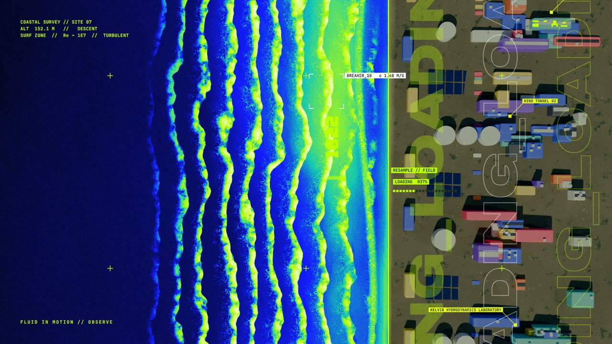
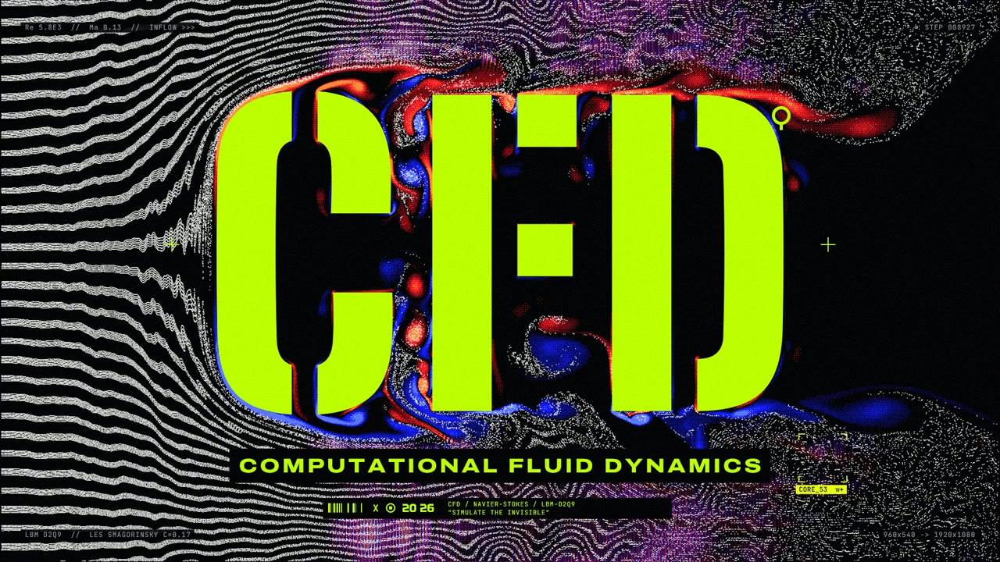
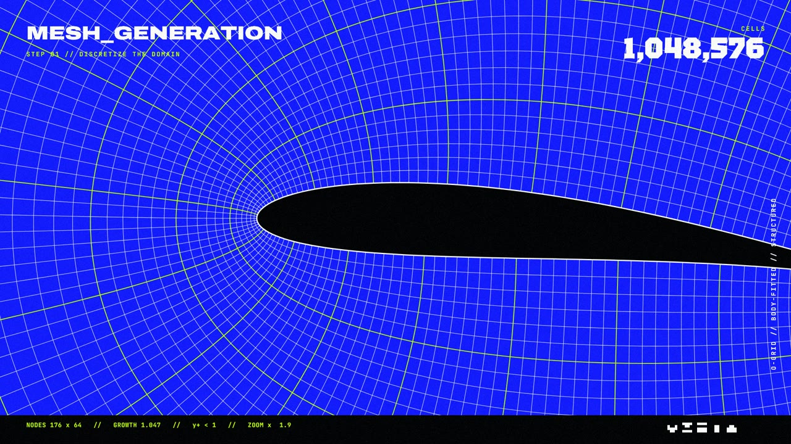
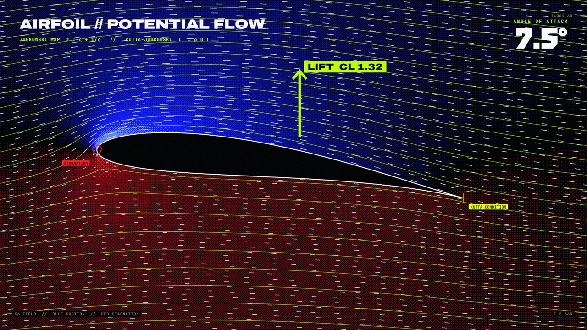
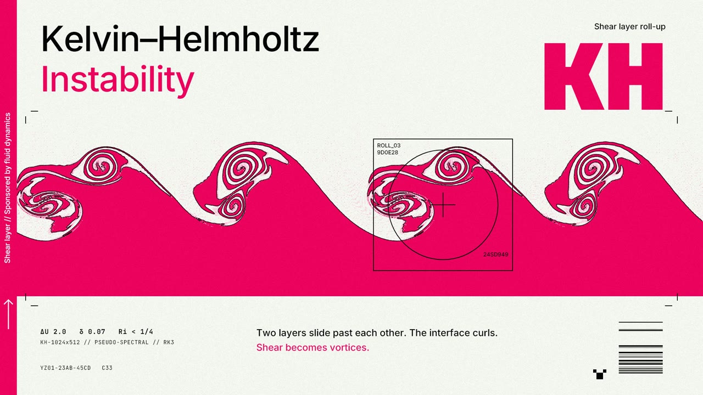
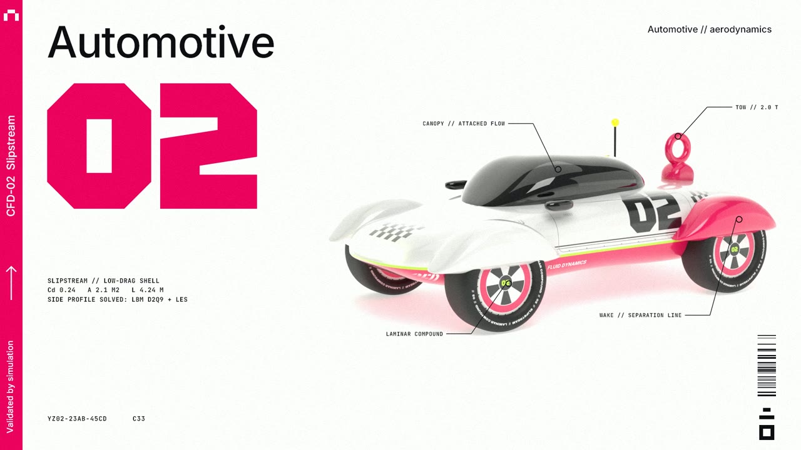
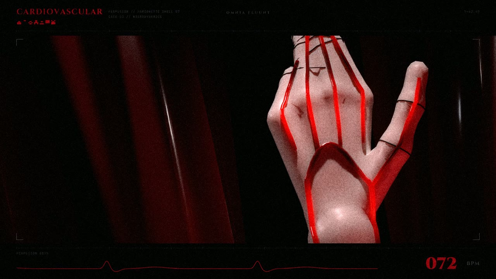
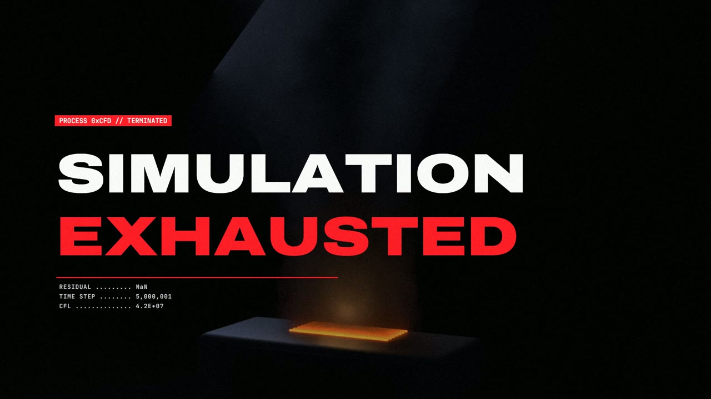

# CFD // ACID

A 110-second motion-design introduction to **Computational Fluid Dynamics**, dressed in the acid
"graphic realism" look of Bungie's *Marathon*. It is meant as a piece of art rather than a lecture, but every
flow on screen is a real simulation: lattice-Boltzmann wakes, a pseudo-spectral Navier–Stokes solver, exact
potential flow around a Joukowski airfoil, and Mantaflow smoke.

**▶ Watch:** download `CFD_ACID.mp4` (1080p30, ~330 MB) from the [latest release](../../releases/latest).

| | |
|---|---|
|  |  |
|  |  |
|  |  |
|  |  |

See [`STORYBOARD.md`](STORYBOARD.md) for the shot list and style bible.

## How it is made

| Stage | Code | Notes |
|---|---|---|
| Simulations | `sims/` | `lbm.py`: D2Q9 lattice-Boltzmann (regularised BGK + Smagorinsky LES, bounce-back, tracer particles, numba). `spectral.py`: pseudo-spectral 2D Navier–Stokes (IF-SSPRK3, 2/3 dealiasing). `geometry.py`: shared shapes (title letters, Joukowski airfoil, car, stenosis). |
| Graphics engine | `engine/core.py`, `fx.py`, `fieldviz.py` | Skia drawing layer, glitch/pixel effects, posterised + Bayer-dithered field colouring, contours. |
| Blender | `vehicle/`, `ocean/` | `vehicle/build_vehicle.py`: procedural CFD-02 car (lofted superellipse body, livery decals from `vehicle/decals.py`), hero turntable + orthographic side render whose silhouette is the LBM obstacle. `ocean/build_ocean.py`: aerial surf shot (ocean modifier + procedural breaker/foam shader, beach, compound). |
| Blender (cont.) | `hand/`, `computer/` | `hand/build_hand.py`: porcelain mannequin hand (metaballs, ray-projected arteries and joint seams, marionette strings) between crimson drapes; the blood front pulses with the heartbeats. `computer/build_computer.py`: beige CRT computer whose screen plays `render/crt_screen/` (from `engine/make_screen.py`), spark particles, Mantaflow smoke. |
| Scenes | `scenes/s_*.py` | One module per shot; `render(t_local, t_global) -> RGB frame`. |
| Soundtrack | `engine/audio.py` | Procedural 120 BPM score (kick/clap/hats, sub, TB-303-style acid line, arps, impacts, risers) and a text-to-speech voice treated as a ship AI. |
| Render | `engine/render.py` | Stills, contact sheets, parallel chunked encode, mux. |

## Rebuilding the film

Requirements: Python 3.13, [ffmpeg](https://ffmpeg.org) on `PATH`, [Blender 5.2](https://www.blender.org/download/)
(Cycles; an NVIDIA GPU with OptiX is assumed), and Windows for the voice-over (it uses the built-in
"Microsoft Hazel" text-to-speech voice). Generated data takes about 11 GB.

```bash
pip install -r requirements.txt
python engine/fetch_fonts.py                                                   # Google Fonts -> assets/fonts
powershell -ExecutionPolicy Bypass -File engine/make_vo.ps1                     # voice lines -> cache/vo

BL=/path/to/blender                                                            # Blender 5.2 executable
python vehicle/decals.py                                                       # livery textures
$BL -b --factory-startup --python vehicle/build_vehicle.py -- side             # side view: car obstacle + compositing
$BL -b --factory-startup --python vehicle/build_vehicle.py -- hero             # 40-frame turntable
python -m sims.build title karman resweep airfoil car stenosis kh turb        # ~10 min CPU, cache/*.npy (~6 GB)
$BL -b --factory-startup --python ocean/build_ocean.py -- frames 0 180         # intro surf, ~9 min on an RTX 4070S
$BL -b --factory-startup --python hand/build_hand.py -- frames 0 90            # perfused hand, ~5 min
python -m engine.make_screen                                                   # CRT screen sequence (needs the sims)
$BL -b --factory-startup --python computer/build_computer.py -- frames          # crash + smoke, ~40 min

python -m engine.audio                                                         # render/soundtrack.wav
python -m engine.render video 8                                                # render/video_noaudio.mp4
python -m engine.render mux                                                    # out/CFD_ACID.mp4
```

Preview a moment or a whole shot without rendering the film:

```bash
python -m engine.render still 13.5 57.0
python -m engine.render sheet s_karman 12
```

## License

- **Code** (`.py`, `.ps1`): [MIT](LICENSE).
- **Film and artwork** (the released video, `docs/stills/`, `STORYBOARD.md`, the vehicle and card designs):
  [CC BY-NC 4.0](LICENSE-ART.md).
- Fonts are downloaded from Google Fonts at build time and keep their own Open Font License.

*Marathon*, NuCaloric and related names belong to Bungie, Inc. This is an unofficial fan homage to the game's
art direction and is not affiliated with or endorsed by Bungie.
